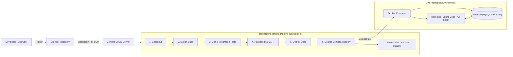

# Automated CI/CD Pipeline for Full Stack Applications
## Academic DevOps Project: Grand Horizon Hotel Management System

A production-grade, end-to-end DevOps demonstration featuring a full-stack Spring Boot & MySQL application automated via a declarative Jenkins CI/CD pipeline and orchestrated with Docker & Docker Compose.

---

## 1. Architectural Workflow



---

## 2. Technology Stack

* **Backend:** Java 17, Spring Boot 3.2.5, Spring Data JPA, Spring Boot Actuator
* **Database:** MySQL 8.0 (with in-memory H2 for isolated CI test execution)
* **Frontend:** HTML5, CSS3, Vanilla JavaScript, Fetch API (Served via Spring Boot static resources)
* **Build Tool:** Apache Maven 3.9.x & Maven Wrapper (`mvnw`, `mvnw.cmd`)
* **Testing:** JUnit 5, Mockito, AssertJ, Spring Boot Test (33 automated tests)
* **Containerization:** Docker (Multi-stage build), Docker Compose
* **CI/CD Automation:** Jenkins (Declarative Pipeline)
* **Version Control:** Git & GitHub

---

## 3. Project Directory Structure

```text
Automated-CICD-Pipeline/
├── .dockerignore
├── .env / .env.example              # Dynamic environment configuration
├── .gitignore
├── docker-compose.yml               # Multi-container orchestration (App + MySQL)
├── Dockerfile                       # Multi-stage production container build
├── Jenkinsfile                      # Root Declarative CI/CD Pipeline
├── mvnw / mvnw.cmd                  # Maven wrappers for Linux and Windows
├── pom.xml                          # Maven dependencies and Surefire plugin
├── README.md                        # Project documentation
│
├── docker/
│   ├── Dockerfile                   # Secondary Dockerfile reference
│   └── mysql/
│       └── init.sql                 # Database schema and seed sample rooms
│
├── jenkins/
│   └── Jenkinsfile                  # Secondary Jenkinsfile reference
│
├── src/
│   ├── main/
│   │   ├── java/com/hotel/management/
│   │   │   ├── controller/          # Room, Booking, and Health REST endpoints
│   │   │   ├── dto/                 # BookingRequest DTO
│   │   │   ├── exception/           # Custom exceptions & GlobalExceptionHandler
│   │   │   ├── model/               # Room and Booking JPA entities
│   │   │   ├── repository/          # Spring Data JPA repositories
│   │   │   ├── service/             # Business logic & transaction management
│   │   │   └── HotelApplication.java# Spring Boot main class
│   │   └── resources/
│   │       ├── application.properties # Production MySQL configuration
│   │       └── static/              # Interactive frontend UI (SPA)
│   │           ├── index.html
│   │           ├── css/styles.css
│   │           └── js/api.js, app.js
│   │
│   └── test/
│       ├── java/com/hotel/management/
│       │   ├── controller/          # MockMvc integration tests
│       │   ├── service/             # Mockito unit tests
│       │   └── HotelApplicationTests.java
│       └── resources/
│           └── application.properties # H2 in-memory test configuration
```

---

## 4. Local Deployment with Docker Compose

Ensure **Docker Desktop** is running, then execute:

```powershell
# 1. Build and start containers in detached mode
docker compose up --build -d

# 2. Check running container status and health
docker compose ps

# 3. View live logs
docker compose logs -f

# 4. Access the application
# Frontend Dashboard: http://localhost:8080/
# Actuator Health:   http://localhost:8080/actuator/health
# Custom Health:     http://localhost:8080/api/health

# 5. Stop containers (preserves database volume)
docker compose down
```

---

## 5. Jenkins Setup & Configuration Guide

### 5.1 Running Jenkins

#### Option A: Running Jenkins via Docker (Recommended)
```powershell
docker run -d `
  --name jenkins `
  -p 8081:8080 `
  -p 50000:50000 `
  -v jenkins_home:/var/jenkins_home `
  -v /var/run/docker.sock:/var/run/docker.sock `
  jenkins/jenkins:lts
```
*(Access Jenkins at `http://localhost:8081`)*

#### Option B: Standalone Java WAR
Download `jenkins.war` and run on port 8081:
```powershell
java -jar jenkins.war --httpPort=8081
```

---

### 5.2 Required Jenkins Plugins

Navigate to **Manage Jenkins** $\rightarrow$ **Plugins** $\rightarrow$ **Available Plugins**, and install:
1. **Git plugin**: For repository cloning and branch tracking.
2. **Pipeline**: Declarative pipeline execution engine.
3. **JUnit Plugin**: Aggregates and visualizes `target/surefire-reports/*.xml`.
4. **AnsiColor**: Colorizes console build logs.
5. **Docker Pipeline & Docker**: Allows Jenkins to interact with Docker daemon.

---

### 5.3 Connecting GitHub to Jenkins

1. **Push your code to GitHub**:
   ```powershell
   git init
   git add .
   git commit -m "feat: complete automated CI/CD hotel management project"
   git branch -M main
   git remote add origin https://github.com/<your-username>/Automated-CICD-Pipeline.git
   git push -u origin main
   ```
2. **Create Jenkins Pipeline Job**:
   * On Jenkins Dashboard, click **New Item**.
   * Enter name: `Hotel-Management-Pipeline`.
   * Select **Pipeline** and click **OK**.
3. **Configure Source Code Management (SCM)**:
   * Scroll down to the **Pipeline** section.
   * Under **Definition**, select **Pipeline script from SCM**.
   * Under **SCM**, choose **Git**.
   * Enter **Repository URL**: `https://github.com/<your-username>/Automated-CICD-Pipeline.git`.
   * Under **Credentials**, add your GitHub Personal Access Token (if private repo).
   * Specify **Branch Specifier**: `*/main`.
   * Ensure **Script Path** is set to `Jenkinsfile`.
4. **Configure Triggers**:
   * Check **GitHub hook trigger for GITScm polling** (for webhooks).
   * Or check **Poll SCM** with schedule `H/5 * * * *` (checks GitHub every 5 minutes).
5. Click **Save**.

---

### 5.4 Executing the Pipeline

1. In your job dashboard, click **Build Now**.
2. Click on the build number (`#1`) and select **Console Output** to observe each stage executing in real time.
3. Upon completion, the **Test Result Trend** graph and **Archived Artifacts** (`target/*.jar`) will be displayed.

---

## 6. Pipeline Stages Explained

```text
+-----------------------------------------------------------------------------------+
| 1. Checkout  -->  2. Maven Build  -->  3. Unit Testing  -->  4. Package Artifact  |
|                                                                                   |
| 5. Docker Image Build  -->  6. Deployment  -->  7. Smoke Test / Health Check      |
+-----------------------------------------------------------------------------------+
```

1. **Stage 1 (Checkout)**: Clones the latest commit from the GitHub repository.
2. **Stage 2 (Maven Build)**: Executes `mvn clean compile`. Aborts if syntax errors or missing classes exist.
3. **Stage 3 (Unit Testing)**: Executes 33 JUnit 5 & Mockito test cases. Generates Surefire reports. If any test fails, the pipeline aborts immediately, preventing broken code from progressing to deployment.
4. **Stage 4 (Package)**: Executes `mvn package -DskipTests` to bundle the application into an executable JAR and archives it in Jenkins.
5. **Stage 5 (Docker Image Build)**: Builds the Docker image tagged with both `hotel-management-app:${BUILD_NUMBER}` and `hotel-management-app:latest`.
6. **Stage 6 (Deployment)**: Executes `docker compose up --build -d` without `-v` flag, ensuring existing MySQL persistent volumes are preserved.
7. **Stage 7 (Smoke Test / Health Check)**: Probes `http://localhost:8080/actuator/health` in a retry loop. Only marks the pipeline successful when HTTP 200 and status `UP` are returned.

---

## 7. Troubleshooting & Common Issues

| Issue | Cause | Resolution |
| :--- | :--- | :--- |
| **Pipeline fails at Stage 3 (Unit Testing)** | An intentional or accidental bug caused a test failure. | Open the **Test Result** tab in Jenkins. Surefire identifies the failing assertion. Fix the bug, commit, and push to GitHub. |
| **Stage 5 fails with "Cannot connect to Docker daemon"** | Docker Desktop is closed, or Jenkins user has no permission. | Ensure Docker Desktop is running. If running Jenkins in Docker, verify `/var/run/docker.sock` is mounted into the container. |
| **Port 8080 already in use** | A local Tomcat/Spring Boot app is already running on the host. | Run `netstat -ano \| findstr 8080` and terminate the occupying PID, or change `APP_PORT=8082` in `.env`. |
| **Stage 7 (Smoke Test) Times Out** | MySQL took longer to become healthy, or bad database credentials. | Check container logs using `docker compose logs hotel-app` and `docker compose logs hotel-db`. Increase retry count in `Jenkinsfile` if host machine is slow. |

---

## 8. College Viva & Examination Demonstration Guide

During your presentation, follow this sequence:
1. **Show the Clean Architecture**: Explain the separation of layers (Controller, Service, Repository, Entity, Static UI).
2. **Show Automated Testing**: Explain that 33 unit and integration tests validate logic and Mockito isolates external dependencies.
3. **Show Environment Parity**: Explain how `.env` and environment variables prevent hardcoding credentials.
4. **Demonstrate Failure Handling (Red Pipeline)**:
   * Change an assertion in `RoomServiceTest.java` to fail intentionally.
   * Push to GitHub $\rightarrow$ watch Jenkins trigger automatically $\rightarrow$ show that the pipeline halts at **Stage 3** and **never touches the production containers**.
5. **Demonstrate Successful Deployment (Green Pipeline)**:
   * Revert the bug and push $\rightarrow$ watch all 7 stages turn **GREEN** $\rightarrow$ open `http://localhost:8080` to demonstrate the live Hotel Management Dashboard.
